# Scroll Scout

[](https://github.com/tkran2/scrollscout/actions/workflows/tests.yml)

**Find where Herculaneum scroll papyrus is clean enough to trace, from public CT data, on a laptop CPU.**

[Report](https://tkran2.github.io/scrollscout/) · [Atlas of the 21 First Letters scrolls](atlas/SUMMARY.md) ·
[Every published segment, checked](census/SEGMENTS.md) · [Quick start](#quick-start)

The [Vesuvius Challenge](https://scrollprize.org) pays $50,000 for the first 10 letters read in a
still-unread scroll (21 eligible scroll volumes, up to 9 more prizes). The first step of every attempt
is the same: grow a surface on the papyrus sheet, then run an ink model on it. Most attempts fail at
that first step. In the [First Letters survey](https://github.com/Bullo27/first-letters-survey), only
12 of 65 automatically grown patches stayed on their sheet over most of their area; the rest crossed
between layers ("layer-crossing swirls") in crushed regions of the scroll, and their ink maps showed
nothing, whatever the model.

Scroll Scout predicts, **before** anyone spends GPU time, whether a seed point will give a clean
surface. It streams a few megabytes of CT and published surface prediction around the point from the
open-data bucket, measures how flat, separate and unfused the papyrus sheets are, and returns one score.
Run over a whole scroll, it maps where the clean papyrus is and recommends seeds. Given a segment that
has already been traced, it checks in about 15 seconds whether the segment stays on its sheet, before
hours of ink detection are spent on it.

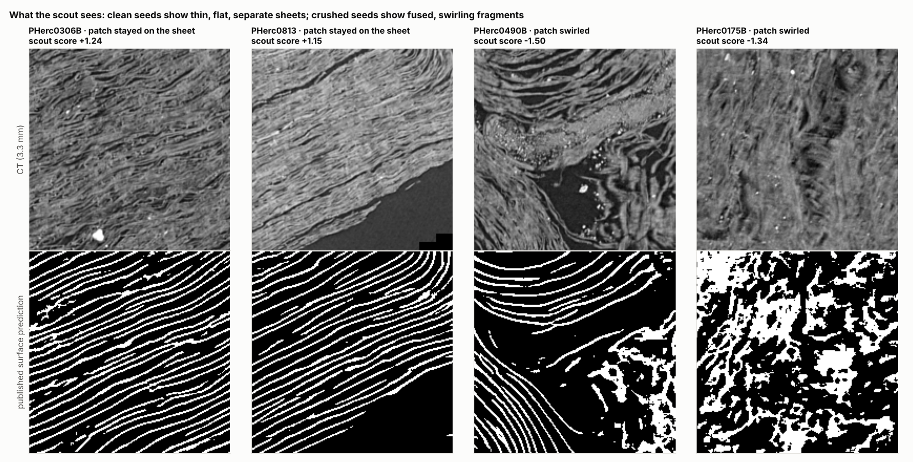

## Does it work?

Three independent tests, each against labels nobody made for this tool:

| test | data | result |
|---|---|---|
| **1. Survey patches** | 65 patches grown with VC3D's GrowPatch on the 21 eligible scrolls, each judged by eye ([First Letters survey](https://github.com/Bullo27/first-letters-survey)) | held-out AUC **0.88** (0.78–0.95), leave-one-scroll-out |
| **2. The team's own segments** | 20 segments the Vesuvius team grew on PHerc. 800 and 1447, two scrolls never used to build or calibrate the score, judged by eye in the same survey | AUC **1.00**, permutation p = 0.0002: every segment that follows the sheet scores above every one that cuts across layers; [`check-segment`](#check-a-segment-before-ink-detection)'s verdict is right for **20 of 20** |
| **3. Known text** | the 18 letters that won the October 2026 First Letters prize (PHerc. 343) and the text the team found in PHerc. 1447 | those places score above **78%** and **100%** of random points in their scrolls |

### 1. Survey patches

Each of the survey's 65 patches was judged by eye as staying on its sheet or not (12 stayed on it):

| | AUC (95% CI) | top-10 seeds that stayed on the sheet |
|---|---|---|
| no ranking (the survey placed its seeds on a fixed grid) | 0.50 | 18% (base rate) |
| **pre-registered score v1** (terms fixed before looking at results) | **0.84** (0.72–0.93), permutation p = 0.0002 | 50% |
| **score v2, leave-one-scroll-out** (terms chosen on the other 20 scrolls, tested on the held-out one) | **0.88** (0.78–0.95), permutation p = 0.0002 | 50% |

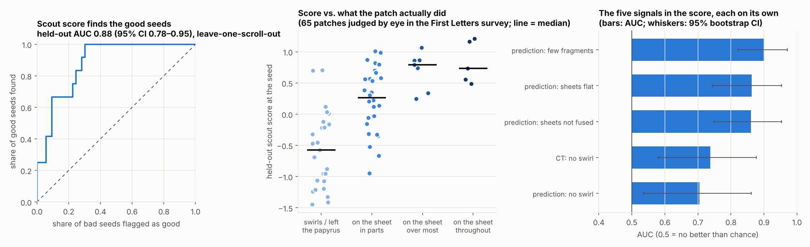

<!-- MESHES:START -->
Scoring each patch over its whole surface with `check-segment` (12 points spread over the patch instead of
the seed alone) gives AUC 0.85 (0.74–0.94) on the same 65 patches. The score was tuned on
these patches, so this checks consistency rather than adding an independent test. The fixed rule is strict on
patches this large (about 12 cm² each): of the 8 it passes, 50% stayed on the sheet
(base rate 18%), and it rejects 92% of the patches that did not, but it passes only
33% of the good ones.
<!-- MESHES:END -->

Four signals are picked in every one of the 21 cross-validation folds: the predicted sheets are **flat**
(structure-tensor planarity), **not fused** into thick slabs, **not fragmented**, and the raw CT texture
**does not swirl** (the last one is model-independent).

The result does not hinge on where the line between good and bad is drawn, or on the scan type
(all held-out, leave-one-scroll-out):

| comparison | held-out AUC (95% CI) |
|---|---|
| stayed on the sheet over most of the patch or more, vs. the rest | 0.88 (0.78–0.95) |
| on the sheet at least in parts, vs. swirled | 0.87 (0.77–0.95) |
| on the sheet throughout, vs. swirled | 0.97 (0.89–1.00) |
| 8.64 µm / 116 keV scans only (32 patches) | 0.91 |
| 9.36 µm / 113 keV scans only (33 patches) | 0.83 |

### 2. The team's own segments

The team published 21 automatically grown segments for PHerc. 800 and PHerc. 1447, and the survey
judged each one: 9 follow the sheet, 11 cut obliquely across several layers, 1 is mixed. Neither
scroll was used to choose the signals or calibrate the score. Scoring 12 points spread over each
segment and taking the median, **all 9 good segments score above all 11 bad ones** (AUC 1.00,
permutation p = 0.0002). Within PHerc. 1447 alone, where 3 good and 11 bad segments share one scroll,
the separation is also perfect (AUC 1.00, p = 0.0014). The closest pair is far apart: the best bad
segment scores +0.12, the worst good one +1.12. This is exactly what
[`scrollscout check-segment`](#check-a-segment-before-ink-detection) does, and its verdict, with a rule
fixed before the test, matches the survey's for all 20 segments.

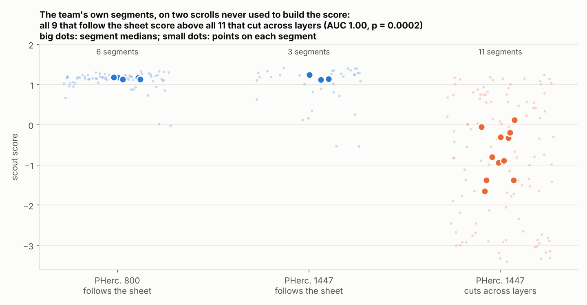

### 3. Where text has actually been found

Two scrolls scanned with the same 8.64 µm / 116 keV protocol as half of the eligible scrolls have
produced text. The scout scored those exact places and compared them with 64 random points inside the
same scroll:

| scroll | text location | scout score there | random points (median) | text beats |
|---|---|---|---|---|
| PHerc. 343 | the 18 letters that won the October 2026 First Letters prize, located on the winner's mesh | 0.66 (median of 18; range 0.44–1.04) | −0.13 | 78% of random points |
| PHerc. 1447 | where the team found text on 24 Sept 2026 (x 4144, y 2742, z 12557), and 1.5 mm around it | 1.38 | 0.48 | 100% of random points |

Both finds sit on papyrus the scout rates in the top quarter of its scroll and above its "clean"
threshold, and both lie in the inner third of the scroll (0.2–0.4 of the way from the axis to the
outside). These are two locations, so treat this as agreement with where text has been read, not as
proof that the score finds ink.

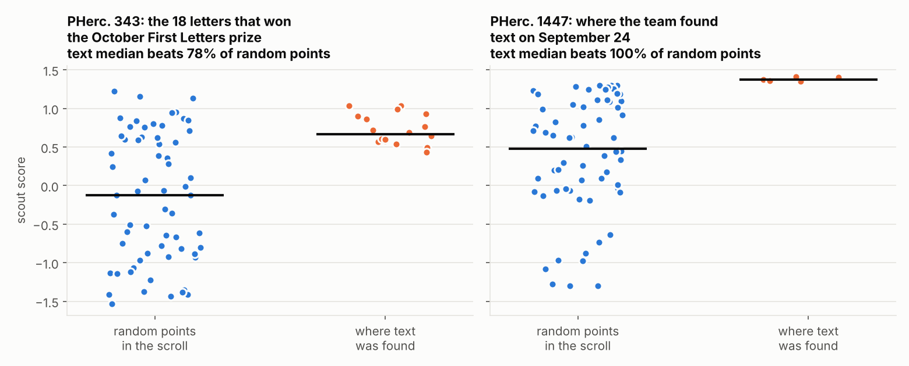

## Check a segment before ink detection

Ink detection on a segment costs GPU hours; checking the segment first costs about 15 seconds on 4 CPU
cores. `check-segment` takes any traced segment (a tifxyz folder from VC3D or `fls.py`, an OBJ mesh, or
an open-data URL), scores 12 points spread over it, and says whether it likely follows its sheet:

```
$ scrollscout check-segment s3://vesuvius-challenge-open-data/PHerc1447/segments/20250502180708-auto_grown_20250502160708188/ --png map.png
20250502180708-auto_grown_20250502160708188: LIKELY CUTS ACROSS LAYERS
  median score -1.65 (clean above 0.63); 1 of 9 scored points clean
  crushed papyrus (score < 0) at x y z: 5186 3273 22590; 5271 2902 24254; 4736 3701 22793; 4619 2816 22186
  no papyrus in the CT around 7 of 12 points (the segment leaves the scroll or the scan there): 5230 3023 23421; ...
  map -> map.png
```

The rule was fixed before it was tested: a segment likely follows the sheet when its median point scores
above the clean threshold (0.63, set on the survey). On the team's 20 judged segments (test 2) it is right
20 times out of 20, and the survey's one mixed segment comes out as likely to cut across layers. The map
shows where a segment runs into crushed papyrus, so a bad stretch can be trimmed before inference instead
of being found after it:

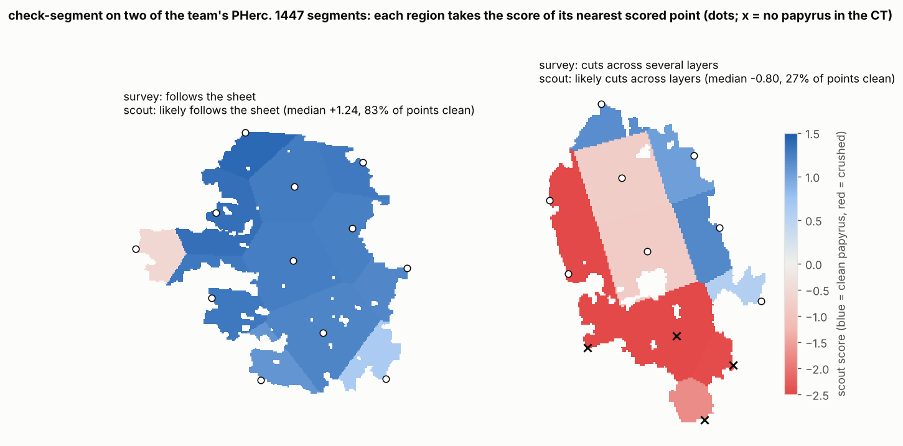

`--json` writes every point's score and features; `--vc3d` writes the points as VC3D point collections.
Several segments at once (`scrollscout check-segment paths/* --csv triage.csv`) give a ranked table.
In a pipeline, `--fail-on-cross` makes the command exit with status 1 unless every segment likely follows
its sheet, so ink detection runs only on segments that pass:

```bash
scrollscout check-segment paths/my_segment --fail-on-cross && ./run_ink_detection.sh paths/my_segment
```

The scroll and volume are read from the path or the tifxyz `meta.json` (`target_volume`); otherwise pass
`--scroll` and `--volume`. Points whose surroundings show no papyrus in the CT (the segment has left the
scroll, or the scan) are listed separately and drawn as crosses on the map.

<!-- CENSUS:START -->
### Every published segment, checked

`check-segment` ran on every segment in the open-data bucket it can check: the 81 segments, on
5 scrolls, with a tifxyz mesh traced on an 8.6–9.4 µm scan that has a published surface prediction
(`scripts/census_segments.py`). **45 of 81** likely follow their sheet. 21 of them were
also judged by eye in the survey (test 2); for the rest the verdicts are predictions, useful for deciding
which segments to run ink detection on, or to train on, first. PHerc. 814 stands out: 18 of its 19 segments run through papyrus the score rates as crushed. The 46 segments of PHerc. 500P2 were not checked: they sit on a 2.215 µm scan, outside the 8.64–9.36 µm scans the score was validated on.

| scroll | segments checked | likely follow the sheet |
|---|---:|---:|
| PHerc. 139 | 38 | 35 |
| PHerc. 814 | 19 | 1 |
| PHerc. 1447 | 15 | 3 |
| PHerc. 800 | 6 | 6 |
| PHerc. 841 | 3 | 0 |

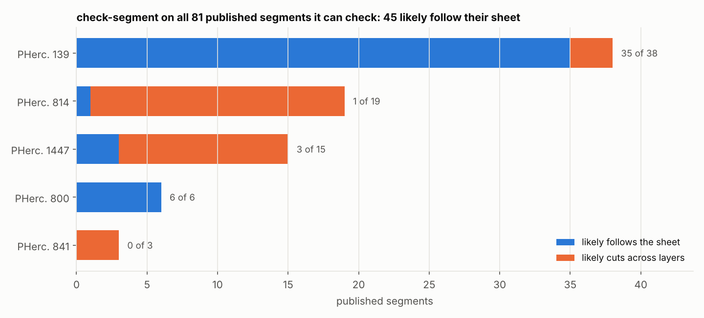

Every segment's verdict, median score, share of clean points and survey verdict:
[`census/SEGMENTS.md`](census/SEGMENTS.md) (also as [`census/segments.csv`](census/segments.csv)).
<!-- CENSUS:END -->

## The atlas: all 21 scrolls still eligible for First Letters

<!-- ATLAS:START -->
4,224 sample points: 128 spread through each of the 21 eligible volumes (8 heights × 4 distances
from the axis), plus PHerc. 125, 175A, 306B and 483A scanned at 512 points each for their seeds. About 3.7 minutes per scroll on 4 CPU cores.
The ranking hardly depends on which points were drawn: an earlier pass with 64 different points per scroll (and the v0.1 feature code) ranks the scrolls almost the same way (Spearman 0.93 on the share of clean points, 0.92 on the best 10%).

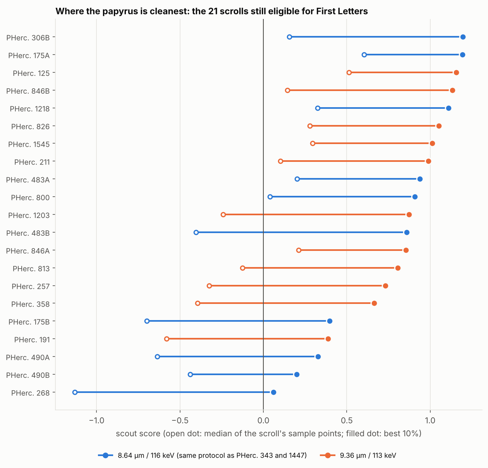

- **Cleanest:** PHerc. 175A (54% of points clean), 125 (53%), 306B (39%), 826 (36%).
- **Most crushed:** PHerc. 268 (0%), PHerc. 490B (3%), PHerc. 175B (7%), PHerc. 490A (8%), PHerc. 191 (9%).
  Automatic tracing will struggle almost everywhere in these.
- **On the 116 keV protocol** of the two scrolls where text has turned up, PHerc. 175A, PHerc. 483A, PHerc. 306B lead.

Top eight, with each scroll's best seed in its inner zone (within 0.45 of the way from the axis to the
outside and away from the top and bottom 15%, where both known text finds lie):

| rank | scroll | scan | share of points clean | best 10% score | best inner seed (x, y, z) | points behind the seed |
|---:|---|---|---:|---:|---|---:|
| 1 | PHerc. 175A | 8.64 µm / 116 keV | 54% | 1.19 | 3062, 4549, 4528 | 512 |
| 2 | PHerc. 125 | 9.36 µm / 113 keV | 53% | 1.19 | 5036, 4920, 16606 | 512 |
| 3 | PHerc. 826 | 9.36 µm / 113 keV | 36% | 1.17 | 5183, 4882, 13759 | 128 |
| 4 | PHerc. 483A | 8.64 µm / 116 keV | 34% | 1.16 | 3085, 4419, 2470 | 512 |
| 5 | PHerc. 846B | 9.36 µm / 113 keV | 33% | 1.08 | 3159, 3779, 6556 | 128 |
| 6 | PHerc. 1545 | 9.36 µm / 113 keV | 34% | 1.07 | 3095, 3682, 8428 | 128 |
| 7 | PHerc. 306B | 8.64 µm / 116 keV | 39% | 1.07 | 5063, 2455, 13347 | 512 |
| 8 | PHerc. 800 | 8.64 µm / 116 keV | 29% | 1.03 | 3786, 5082, 11673 | 128 |

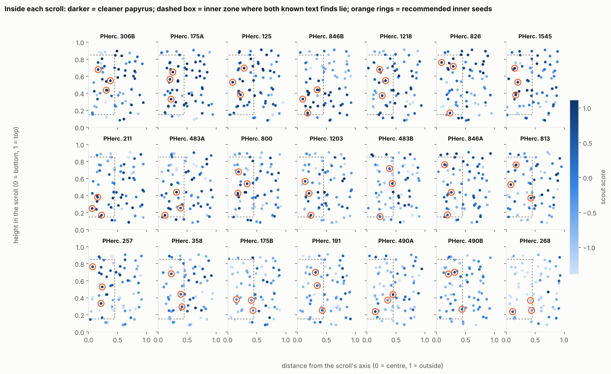

Cross-sections through the best inner seeds of the densely scanned scrolls (blue = clean, red =
crushed, white ring = seed):

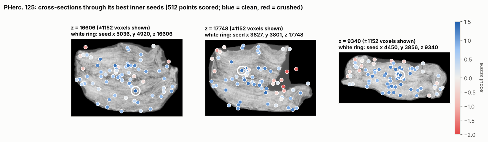

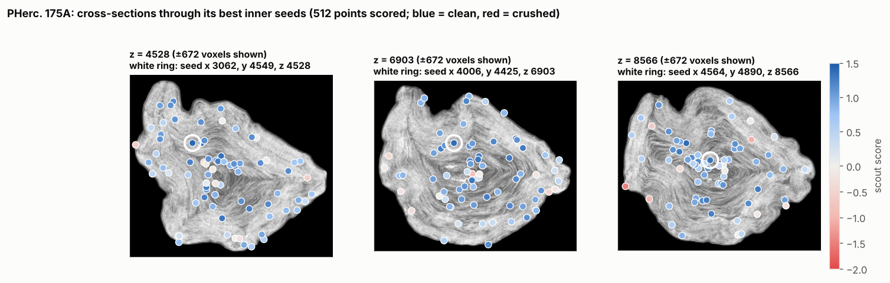

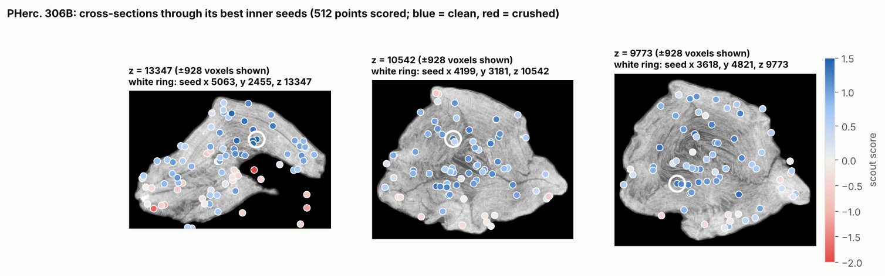

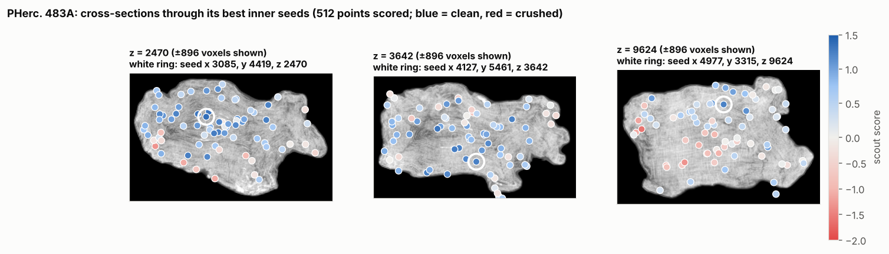

All 21 scrolls: [`atlas/SUMMARY.md`](atlas/SUMMARY.md). Every seed (5 overall and 3 inner per scroll):
[`atlas/seeds.csv`](atlas/seeds.csv). Every sample point with all its features: `atlas/<scroll>.json`.
VC3D point collections for every scroll (clean, middling and crushed points, and seeds):
`atlas/vc3d/<scroll>.vc3d_points.json`.
<!-- ATLAS:END -->

## Quick start

```bash
pip install "git+https://github.com/tkran2/scrollscout"     # or: pip install -e . from a clone

# score one point (level-0 voxel x y z of a volume): here, where the team found text in PHerc. 1447
scrollscout point PHerc1447 20250521151220 4144 2742 12557
#  -> "score": 1.38, "verdict": "clean (good seed)"   (15 s on a laptop CPU)

# best seeds around a target (a 3 x 3 x 3 grid, 300 voxels apart), e.g. around that text find
scrollscout near PHerc1447 20250521151220 4144 2742 12557

# check a traced segment (tifxyz folder, OBJ or open-data URL) before running ink detection on it
scrollscout check-segment path/to/segment.tifxyz --png map.png

# scan a whole scroll volume: 128 sample points, ~5 min on 4 CPU cores, then seeds
scrollscout scan PHerc0306B 20250521133212 --points 128 --out PHerc0306B.json
scrollscout seeds PHerc0306B.json

# the same result as VC3D point collections: clean / middling / crushed points and seeds, colour-coded
scrollscout export-vc3d PHerc0306B.json

# every First Letters eligible volume, ranked
scrollscout atlas --out atlas/
```

No GPU, no VC3D install, no full-volume downloads: everything streams chunk by chunk from
`s3://vesuvius-challenge-open-data` over HTTPS (public, no account). Chunks are cached in
`~/.cache/scrollscout` (set `SCROLLSCOUT_CACHE` to move it, or `SCROLLSCOUT_NO_CACHE=1` to stream only).
Use `--live` to read the current open-data catalog instead of the bundled 31 Oct 2026 snapshot.

The seeds plug straight into VC3D (*Create Segment (GrowPatch)*) or the survey's tool:
`python fls.py run --scroll PHerc0306B --seed X Y Z --gens 100`. `export-vc3d` writes the scored points
in VC3D's point-collections JSON (`vc_pointcollections_json_version` 1), in the volume's level-0
voxel frame.

## How it works

For each point, Scroll Scout reads a 192³-voxel cube (3.3 mm at 8.6 µm) at pyramid level 1 of both the
CT and the published `surface-m7` prediction, and measures:

| signal | what it measures | why |
|---|---|---|
| `pred_planarity` | energy-weighted (λ₁−λ₂)/λ₁ of the structure tensor of the prediction | flat, parallel sheets have one dominant gradient direction |
| `pred_thick` | share of predicted surface deeper than 2 voxels from its boundary | in crushed regions the model predicts fused slabs instead of thin sheets ([Jeong](https://github.com/Jinhojeong/vesuvius-surface-geometry-diagnostic)) |
| `pred_ncomp_per_kvox` | connected fragments per 1,000 predicted voxels | continuous sheets vs. broken bits |
| `pred_dispersion` | spread of the dominant sheet normal across 48³ sub-blocks | swirls and folds turn the sheets inside the cube |
| `ct_dispersion` | the same on the raw CT | a model-independent check |

Each signal is z-scored against the survey reference set and signed so that higher = cleaner; the
score is their mean (`scrollscout/score.py`). A seed is "clean" above 0.63, the score that 75% of the
survey's on-sheet seeds exceed.

`check-segment` picks 12 nodes spread evenly over the segment (farthest-point sampling on the tifxyz
grid, whose spacing is close to even on the surface; texture coordinates for an OBJ), scores each one
like any other point, and compares the median with the same 0.63 threshold (`scrollscout/segment.py`).
`near` scores a 3 × 3 × 3 grid around a target, keeping the points the coarse CT shows as papyrus.

**Speed.** A point takes about 4.5 s on one CPU core (about 17 s in v0.1): each cube's structure tensor
is computed once and reused for both the whole-cube planarity and the 64 per-block normals behind the
swirl signals, the wide smoothing runs on a half-resolution grid, and the fused-sheet signal uses an
erosion that is exactly equivalent to the distance-transform test. Re-validated on all 65 survey
patches: leave-one-scroll-out AUC unchanged at 0.88.

## Reproduce everything

```bash
python -I scripts/eval_survey.py --survey data/first_letters_survey_results.json \
    --index data/catalog_index_2026-10-31.json --out results/survey_features.json   # ~10 min
python -I scripts/analyze_survey.py results/survey_features.json                  # v1 score, per-signal AUCs
python -I scripts/crossval.py results/survey_features.json                        # v2, leave-one-scroll-out
python -I scripts/eval_text_regions.py --index data/catalog_index_2026-10-31.json \
    --calibration results/calibration.json --n-random 64 --out results/text_regions.json \
    --mesh <pherc343-first-letters>/outputs/concat_w047-w048_R5B2_z9500-11000.tifxyz \
    --letters <pherc343-first-letters>/inputs/concat_w047-w048_R5B2_z9500-11000_letter_boxes.json
python -I scripts/eval_team_segments.py --survey data/first_letters_survey_results.json \
    --index data/catalog_index_2026-10-31.json --calibration results/calibration.json \
    --out results/team_segments.json                          # the team's 21 segments, via check-segment
SCROLLSCOUT_NO_CACHE=1 python -I scripts/eval_survey_meshes.py --survey-repo <first-letters-survey> \
    --calibration results/calibration.json --out results/survey_meshes.json      # check-segment, 65 patches
SCROLLSCOUT_NO_CACHE=1 python -I scripts/census_segments.py --calibration results/calibration.json  # every published segment
SCROLLSCOUT_NO_CACHE=1 python -I scripts/build_atlas.py --index data/catalog_index_2026-10-31.json \
    --eligibility data/prize_eligibility_2026-10-31.json --calibration results/calibration.json \
    --points 128 --out atlas                                                      # ~1.7 h on 4 cores
SCROLLSCOUT_NO_CACHE=1 python -I scripts/dense_scan.py --calibration results/calibration.json \
    --points 384 PHerc0175A PHerc0125 PHerc0483A PHerc0306B                       # 512 points each
python -I scripts/atlas_stability.py                                              # ranking vs. the 64-point pass
python -I scripts/summarize_atlas.py atlas
python -I scripts/update_docs.py                                                  # README atlas section, VC3D files
python -I scripts/make_figures.py
python -m pytest tests                                                            # 35 tests, offline
```

## Limitations

- **The labels come from one person's eye**: the survey's 65 patches and its verdicts on the team's 21
  segments were judged by the same person. The team-segment test covers a second tracer run (the
  team's auto-growing) on two new scrolls, but 20 segments is a small set, and pooling PHerc. 800 with
  PHerc. 1447 mixes scrolls; the within-PHerc. 1447 result (AUC 1.00, p = 0.0014) avoids that.
  Spiral fits and lasagna surfaces are untested.
- **check-segment judges the papyrus a segment passes through, not the segment's own path.** A segment
  that jumped layers inside clean papyrus would pass; none of the 20 test segments did, but the check is
  only as good as that correlation.
- **A clean surface is necessary, not sufficient.** The scout says where tracing will work, not where
  the ink is. It is meant to point ink models at the places where they have a chance.
- **Sampling is coarse.** 128 points per scroll (512 for the four densely scanned ones) cover each
  scroll in 8 height × 4 radius bands; the atlas seeds are the best of those, not the best in the
  scroll. `scrollscout scan --points 512` samples more densely.
- The score inherits the blind spots of the `surface-m7` model it partly reads.
- **Validated on 8.64 µm and 9.36 µm scans only.** Other resolutions get a warning. Where the surface
  prediction is stored coarser than the CT's level 1 (the 2.2 µm PHerc. 500P2 scan), points are not
  scored rather than scored wrongly.

## Credits and data

- CT scans and surface predictions: [Vesuvius Challenge](https://scrollprize.org) open data, CC BY-NC 4.0.
  Figures derived from them carry the same licence.
- Ground truth: the [First Letters survey](https://github.com/Bullo27/first-letters-survey) by Matteo Bulloni (MIT).
- PHerc. 343 letter locations: [Erwin Nieuwlaar's winning submission](https://github.com/Nieuwlaar/pherc343-first-letters) (MIT).
- Catalog and prize eligibility: [ScrollPrize/villa](https://github.com/ScrollPrize/villa), snapshot of 31 October 2026.

Code: MIT.
